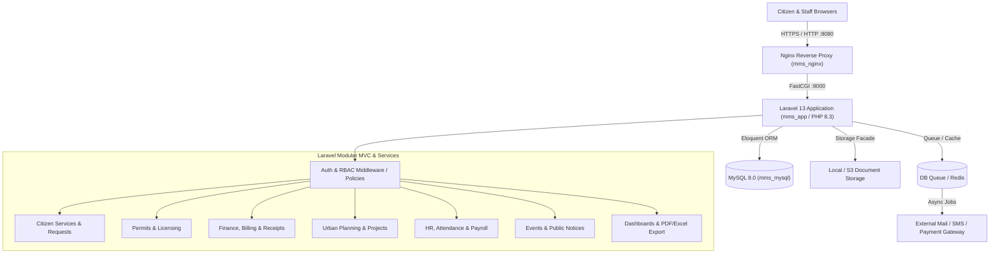
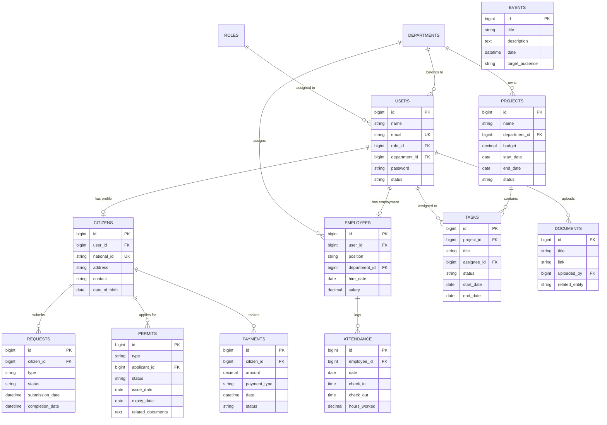

> **Purpose**
>
> Describe **how** the team will implement the MVP defined in its Product Requirements Document (`docs/PRD.md`), grounded in the approved SRS (`Municipality Management System - SRS (Laravel)`) and Conceptual Data Model (`php.cdm`). The TDD makes the architecture, data model, interfaces, security controls, failure handling, testing, and deployment plan reviewable **before implementation begins**.

---

## Document Control

| Field | Team response |
| --- | --- |
| Project name | Municipality Management System (MMS) |
| Development track | Laravel (PHP 8.3) — Web-based Application |
| Team leader | Jad Assaf |
| Team members and responsibilities | • Jawad Koeik Hamza Hussein Hadi shehab Jad Assaf Sarah mazeh Ghadeer ghaith /  Dr. Ali Ghorayeb (SRS Author / Supervisor) |
| TDD version | 1.0 |
| Last updated | 27-11-2026 |
| PRD reference | `docs/PRD.md` (Version 1.0) |
| CDM reference | `php.cdm` (PowerDesigner CDM, 11 core entities) |
| Review status | Draft |

### Executive Technical Summary

The Municipality Management System (MMS) is a modular **Laravel 13 (PHP 8.3)** web application backed by **MySQL 8.0**, **Nginx**, and **Redis** (optional/configured for cache/queues), containerized with **Docker Compose**. The application follows Laravel's MVC architecture with a unified **Arabic-first (RTL)** web frontend (Blade + Tailwind CSS v4 + Vite 8, `dir="rtl"`, `lang="ar"`) and RESTful API endpoints for integrations, enforcing server-side Role-Based Access Control (RBAC) across six municipal roles. All core entities from the Conceptual Data Model (`users`, `citizens`, `requests`, `permits`, `payments`, `projects`, `tasks`, `employees`, `attendance`, `events`, `documents`) plus supporting `roles` and `departments` lookup tables are persisted in MySQL with strict foreign-key integrity. For the MVP, payment processing, SMS, and email notifications are implemented behind service interfaces using **mock/log adapters**, while PDF/Excel exports (with Arabic-capable PDF rendering) and audit trails ensure municipal transparency and compliance.

### Requirements Traceability

| PRD ID | Requirement / workflow | Proposed component(s) | Test reference |
| --- | --- | --- | --- |
| R1 | Citizen Services & Request Management | `CitizenController`, `ServiceRequestController`, `citizens`, `requests` tables, Notification Jobs | T-01, T-02 |
| R2 | Permits & Licensing Workflow | `PermitController`, `DocumentService`, `permits`, `documents` tables | T-03 |
| R3 | Finance, Billing & Payment Tracking | `PaymentController`, `ReceiptService`, `payments` table, Payment Gateway Adapter | T-04 |
| R4 | Urban Planning & Municipal Projects | `ProjectController`, `TaskController`, `projects`, `tasks`, `documents` tables | T-05 |
| R5 | Human Resources & Staff Management | `EmployeeController`, `AttendanceController`, `PayrollService`, `employees`, `attendance` tables | T-06 |
| R6 | Events, Public Notices & Reporting Dashboards | `EventController`, `ReportController`, `events` table, PDF/Excel exporters | T-07 |
| R7 | Authentication, Multi-Department & RBAC | Laravel Auth, `RoleMiddleware` / Policies, `users`, `roles`, `departments` tables | T-08, T-09 |

---

## 1. Technology Stack

| Layer | Technology / version | Responsibility | Justification |
| --- | --- | --- | --- |
| Frontend / UI | Laravel Blade + Tailwind CSS `^4.0.0` + Vite `^8.0.0` (**Arabic RTL**, `dir="rtl"`, `lang="ar"`) | Server-rendered Arabic Citizen Portal, Admin/Staff Dashboards, Forms, `lang/ar/` translations | Already configured in `package.json` and `vite.config.js`; Tailwind v4 logical/RTL utilities cleanly support Arabic-first UI without SPA overhead |
| Backend / API | Laravel `^13.17` on PHP `^8.3` (FPM) | Business logic, MVC controllers, FormRequest validation, Policies, REST API | Specified by SRS and already initialized in `composer.json` and `Dockerfile` |
| Database | MySQL `8.0` | Primary relational data store | Configured in `docker-compose.yml` (`mms_mysql`); provides ACID transactions and strict FK integrity |
| ORM / database access | Laravel Eloquent ORM & Migrations | Schema management, relationships, query building | Built into Laravel; enforces clean model relationships and migration versioning |
| Authentication & RBAC | Laravel Session Auth + Sanctum (for API) + Laravel Policies/Middleware | Login, SSO readiness, role/department enforcement | Native Laravel security with bcrypt (`BCRYPT_ROUNDS=12`), CSRF/XSS protection |
| Cache / Queues | Database driver (current `.env.example`) / Redis (production target per SRS) | Background email/SMS notifications, scheduled reports | Configured for zero-extra-infra locally via DB driver, seamlessly switchable to Redis |
| File storage | Laravel `Storage` (`local` disk in dev, S3-compatible in prod) | Permit attachments, project documents, generated receipts | Native abstraction already wired in `.env.example` (`FILESYSTEM_DISK`) |
| Web Server / Container | Nginx (`nginx:stable-alpine`) + Docker Compose | Reverse proxy to `php-fpm` (`mms_app:9000`) on port `8080` | Already implemented in `docker-compose.yml` and `Docker/nginx.conf` |
| Testing / CI | PHPUnit `^12.5.12`, Laravel Pint `^1.27`, Mockery `^1.6` | Unit, feature, and RBAC integration tests; PSR-12 formatting | Pre-installed in `composer.json` (`require-dev`) |

**External dependencies (confirmed MVP mocks):**
- **Mock Payment Gateway (`MockPaymentGateway`):** Implements `PaymentGatewayInterface` to simulate payment approval/decline flows and generate receipt numbers locally without live bank credentials.
- **Mock SMS & Email Notifications (`LogSmsService` + `MAIL_MAILER=log`):** Implements `SmsServiceInterface` and Laravel Notifications, logging/storing simulated SMS & email payloads asynchronously via Laravel Queues so all notification triggers are testable without external providers.
- **Arabic PDF Generation:** Use an Arabic-shaping-compatible PDF library (e.g., `mpdf` / `niklasravnsborg/laravel-pdf` or headless browser PDF) for receipts and exported reports so Arabic text renders properly right-to-left.

---

## 2. System Architecture

### 2.1 Architecture Diagram



### 2.2 Component Responsibilities

| Component | Responsibility | Inputs / dependencies | Outputs / connected components |
| --- | --- | --- | --- |
| Nginx (`mms_nginx`) | Terminates HTTP(S), serves static Vite assets, proxies PHP requests | Browser HTTP requests | FastCGI requests to `mms_app:9000` |
| Auth & RBAC Layer | Authenticates users, enforces 6-role permissions and department scoping | Credentials, session/token, Policies | Authorized request context or `403`/`401` |
| Citizen Services Module | Manages citizen profiles and certificate/service requests | Citizen input, `requests` & `citizens` | Persisted requests, audit trail, notification jobs |
| Permits & Licensing Module | Handles permit applications, document uploads, review & renewal | Applicant data, uploaded files | `permits` & `documents` records |
| Finance & Billing Module | Manages property tax, utility bills, payments, and PDF receipts | Payment requests, gateway callbacks | `payments` records, receipts, budget summaries |
| Urban Planning Module | Tracks municipal projects, tasks, budgets, and timelines | Planner input, `projects` & `tasks` | Project progress & archived `documents` |
| HR & Staff Module | Manages employees, attendance check-in/out, leaves, and payroll | Staff/HR input, `employees` & `attendance` | Calculated hours, payroll runs |
| Events & Reporting Module | Publishes events/notices; aggregates analytics & exports PDF/Excel | Cross-module queries | Calendar views, PDF/Excel files |
| MySQL 8.0 (`mms_mysql`) | Stores all relational data with ACID transactions & FK constraints | Eloquent queries | Persisted entities & query results |

### 2.3 Primary Request / Data Flow

1. **Authentication:** User submits credentials to `/login`; Laravel verifies bcrypt password hash, creates an authenticated session (or Sanctum token), and loads `role_id` and `department_id`.
2. **Citizen Request Submission:** Authenticated Citizen submits a request (`POST /requests`) validated by a `FormRequest`. Controller creates a `requests` row (`status = pending`, `submission_date = now()`) and dispatches a queued notification.
3. **Staff Review & Action:** Clerk or Officer views department-scoped queue (`GET /requests`), updates status (`PATCH /requests/{id}`), or issues a permit/receipt. Policies verify role and ownership before any mutation.
4. **Payment & Receipting:** Citizen or Finance Officer initiates payment (`POST /payments`); gateway adapter processes or records the transaction inside a DB transaction, updates `status = paid`, and generates a downloadable receipt.
5. **Cross-Cutting Audit & Reporting:** Reporting controllers query aggregated read-only views and stream PDF/Excel exports without blocking transactional tables.

### 2.4 Architecture Boundaries

- **Modular Monolith:** All 7 municipal modules run within one Laravel codebase, organized cleanly by domain Controllers, Services, FormRequests, and Policies.
- **State Ownership:** MySQL 8.0 is the single source of truth for all transactional data; file binaries live on Laravel `Storage` with metadata paths in `documents`.
- **Deliberately Excluded Complexity:** No microservices, no distributed event bus, no multi-tenant database-per-municipality partitioning in MVP.

---

## 3. Data Model & Entity–Relationship Diagram (ERD)

### 3.1 ER Diagram

The following ERD reflects all **11 core entities** from `php.cdm` and SRS Section 6, plus `roles` and `departments` referenced by `role_id` and `department_id`.



### 3.2 Entity Catalog

*Note: Attribute names below reconcile the Conceptual Data Model (`php.cdm`) with clean snake_case MySQL column names (e.g., CDM `Uid` → `id`, `Uname` → `name`, `Uemail` → `email`, `submissiom_date` → `submission_date`, `nationals_id` → `national_id`).*

| Entity | CDM Name (Code) | Purpose | Key Attributes | Relationships |
| --- | --- | --- | --- | --- |
| **users** | Users (`USERS`) | Stores all system accounts and credentials | `id` (PK), `name`, `email` (UK), `role_id` (FK), `department_id` (FK), `password`, `status` | 1:0..1 → `citizens`, 1:0..1 → `employees`, 1:N → `tasks`, 1:N → `documents` |
| **citizens** | Citizens (`CITIZENS`) | Stores citizen civil & contact profile | `id` (PK), `user_id` (FK), `national_id` (UK), `address`, `contact`, `date_of_birth` | N:1 → `users`, 1:N → `requests`, 1:N → `permits`, 1:N → `payments` |
| **requests** | Requests (`REQUESTS`) | Stores certificate, service, and complaint requests | `id` (PK), `citizen_id` (FK), `type`, `status`, `submission_date`, `completion_date` | N:1 → `citizens` |
| **permits** | Permits (`PERMITS`) | Stores business, construction, vehicle, event permits | `id` (PK), `type`, `applicant_id` (FK), `status`, `issue_date`, `expiry_date`, `related_documents` | N:1 → `citizens` |
| **payments** | Payments (`PAYMENTS`) | Stores property tax & utility payments | `id` (PK), `citizen_id` (FK), `amount`, `payment_type`, `date`, `status` | N:1 → `citizens` |
| **projects** | Projects (`PROJECTS`) | Tracks municipal infrastructure & urban projects | `id` (PK), `name`, `department_id` (FK), `budget`, `start_date`, `end_date`, `status` | N:1 → `departments`, 1:N → `tasks` |
| **tasks** | Tasks (`TASKS`) | Tracks work items within municipal projects | `id` (PK), `project_id` (FK), `title`, `assignee_id` (FK), `status`, `start_date`, `end_date` | N:1 → `projects`, N:1 → `users` |
| **employees** | Employees (`EMPLOYEES`) | Stores municipal staff employment & salary data | `id` (PK), `user_id` (FK), `position`, `department_id` (FK), `hire_date`, `salary` | N:1 → `users`, N:1 → `departments`, 1:N → `attendance` |
| **attendance** | Attendance (`ATTENDANCE`) | Tracks daily check-in/out and hours worked | `id` (PK), `employee_id` (FK), `date`, `check_in`, `check_out`, `hours_worked` | N:1 → `employees` |
| **events** | Events (`EVENTS`) | Stores municipal events & public announcements | `id` (PK), `title`, `description`, `date`, `target_audience` | Standalone (targeted by audience/department) |
| **documents** | Documents (`DOCUMENTS`) | Centralized document archive linked to entities | `id` (PK), `title`, `link`, `uploaded_by` (FK), `related_entity` | N:1 → `users` |

### 3.3 Data Lifecycle

1. **Creation:** Citizens self-register (`users` + `citizens` created in one DB transaction); Admins provision staff accounts (`users` + `employees`). Citizens create `requests` and `permits`; Finance Officers or payment callbacks create `payments`; Planners create `projects` and `tasks`.
2. **Update:** Statuses on `requests`, `permits`, `projects`, `tasks`, and `payments` are updated only via authorized controllers/services with policy checks.
3. **Archival / Deletion:** Soft deletes (`deleted_at`) or status deactivation (`status = inactive` / `archived`) are used instead of hard deletes to preserve municipal audit trails, financial records, and historical documents.
4. **Audit Requirements:** Timestamps (`created_at`, `updated_at`) are maintained on all tables; `documents` records `uploaded_by` and `related_entity`; sensitive status/payment mutations are logged.

---

## 4. Database Schema & Data Integrity

### 4.1 Database Overview

MMS uses **MySQL 8.0** (`Municipality-Management-System` database) with InnoDB engine, UTF8MB4 charset, and Laravel migrations. It implements the 11 core CDM tables plus `roles` and `departments` (and Laravel's built-in `cache`, `jobs`, and `sessions` tables already present in `database/migrations/`).

### 4.2 Database Schema (Core Tables)

1. **`roles` & `departments`** (Lookup Tables)
   - `roles`: `id` (BIGINT PK), `name` (VARCHAR(50) UNIQUE), `slug` (VARCHAR(50) UNIQUE)
   - `departments`: `id` (BIGINT PK), `name` (VARCHAR(100) NOT NULL), `branch` (VARCHAR(100) NULL)

2. **`users`** (Authentication — extending default Laravel migration)
   - `id` (BIGINT PK), `name` (VARCHAR(100) NOT NULL), `email` (VARCHAR(255) UNIQUE NOT NULL), `role_id` (BIGINT FK → `roles.id`), `department_id` (BIGINT FK → `departments.id`, NULLABLE), `password` (VARCHAR(255) NOT NULL), `status` (ENUM: `active`, `inactive`, `suspended` DEFAULT `active`), timestamps.

3. **`citizens`**
   - `id` (BIGINT PK), `user_id` (BIGINT UNIQUE FK → `users.id`), `national_id` (VARCHAR(50) UNIQUE NOT NULL), `address` (TEXT NOT NULL), `contact` (VARCHAR(50) NOT NULL), `date_of_birth` (DATE NOT NULL), timestamps.

4. **`requests`**
   - `id` (BIGINT PK), `citizen_id` (BIGINT FK → `citizens.id`), `type` (VARCHAR(50) NOT NULL — e.g. `residency`, `birth`, `death`, `marriage`, `garbage`, `street_repair`, `complaint`), `description` (TEXT NULL), `status` (ENUM: `pending`, `in_review`, `approved`, `rejected`, `completed` DEFAULT `pending`), `submission_date` (DATETIME NOT NULL), `completion_date` (DATETIME NULL), timestamps.

5. **`permits`**
   - `id` (BIGINT PK), `type` (VARCHAR(50) NOT NULL — `business`, `construction`, `vehicle`, `event`), `applicant_id` (BIGINT FK → `citizens.id`), `status` (ENUM: `submitted`, `under_review`, `approved`, `rejected`, `expired` DEFAULT `submitted`), `issue_date` (DATE NULL), `expiry_date` (DATE NULL), `related_documents` (JSON/TEXT NULL), timestamps.

6. **`payments`**
   - `id` (BIGINT PK), `citizen_id` (BIGINT FK → `citizens.id`), `amount` (DECIMAL(12,2) NOT NULL, CHECK `>= 0`), `payment_type` (VARCHAR(50) NOT NULL — `property_tax`, `water`, `electricity`, `waste`, `permit_fee`), `date` (DATETIME NOT NULL), `status` (ENUM: `pending`, `paid`, `failed`, `refunded` DEFAULT `pending`), `receipt_number` (VARCHAR(50) UNIQUE NULL), timestamps.

7. **`projects`**
   - `id` (BIGINT PK), `name` (VARCHAR(150) NOT NULL), `department_id` (BIGINT FK → `departments.id`), `budget` (DECIMAL(14,2) NOT NULL, CHECK `>= 0`), `start_date` (DATE NOT NULL), `end_date` (DATE NULL), `status` (ENUM: `planned`, `in_progress`, `on_hold`, `completed`, `cancelled` DEFAULT `planned`), timestamps.

8. **`tasks`**
   - `id` (BIGINT PK), `project_id` (BIGINT FK → `projects.id`), `title` (VARCHAR(150) NOT NULL), `assignee_id` (BIGINT FK → `users.id`), `status` (ENUM: `todo`, `in_progress`, `review`, `done` DEFAULT `todo`), `start_date` (DATE NULL), `end_date` (DATE NULL), timestamps.

9. **`employees`**
   - `id` (BIGINT PK), `user_id` (BIGINT UNIQUE FK → `users.id`), `position` (VARCHAR(100) NOT NULL), `department_id` (BIGINT FK → `departments.id`), `hire_date` (DATE NOT NULL), `salary` (DECIMAL(12,2) NOT NULL, CHECK `>= 0`), timestamps.

10. **`attendance`**
    - `id` (BIGINT PK), `employee_id` (BIGINT FK → `employees.id`), `date` (DATE NOT NULL), `check_in` (TIME NULL), `check_out` (TIME NULL), `hours_worked` (DECIMAL(5,2) NULL), UNIQUE(`employee_id`, `date`), timestamps.

11. **`events`**
    - `id` (BIGINT PK), `title` (VARCHAR(150) NOT NULL), `description` (TEXT NOT NULL), `date` (DATETIME NOT NULL), `target_audience` (VARCHAR(100) NOT NULL — `all`, `citizens`, `staff`, or department), timestamps.

12. **`documents`**
    - `id` (BIGINT PK), `title` (VARCHAR(150) NOT NULL), `link` (VARCHAR(500) NOT NULL), `uploaded_by` (BIGINT FK → `users.id`), `related_entity` (VARCHAR(100) NOT NULL — e.g. `permit:12`, `project:4`), timestamps.

### 4.3 Data Integrity & Security Rules

- **Foreign Keys:** All FKs use `ON DELETE RESTRICT` (or `CASCADE` only where appropriate for profile extensions) to prevent orphaned municipal records.
- **Transactions:** Multi-table operations (user+citizen registration, payment+receipt generation, payroll processing) execute inside `DB::transaction()`.
- **Validation:** Every input is validated via Laravel `FormRequest` classes before reaching models.
- **No Plaintext Secrets:** Passwords use `Hash::make()` (bcrypt); `.env` secrets are excluded from Git.

---

## 5. API & Interface Design

### 5.1 Route / Endpoint Overview

Web routes (`routes/web.php`) serve Blade views for the Citizen Portal and Staff Dashboards; API routes (`routes/api.php`, prefixed `/api/v1`) support integrations and async UI actions.

| ID | Method | Path | Required Role | Purpose | PRD Ref |
| --- | --- | --- | --- | --- | --- |
| EP-01 | POST | `/register` | Public | Register a Citizen account (forces Citizen role) | R7 |
| EP-02 | POST | `/login` | Public | Authenticate user session / API token | R7 |
| EP-03 | GET / POST | `/requests` | Citizen (own) / Clerk / Admin | List or submit certificate/service requests | R1 |
| EP-04 | PATCH | `/requests/{id}/status` | Clerk / Admin | Update request status & trigger notification | R1 |
| EP-05 | GET / POST | `/permits` | Citizen (own) / Clerk / Admin | Apply for or list permits | R2 |
| EP-06 | PATCH | `/permits/{id}/review` | Clerk / Admin | Approve/reject permit, set issue & expiry dates | R2 |
| EP-07 | GET / POST | `/payments` | Citizen (own) / Finance Officer | View bills, pay online, or record payment | R3 |
| EP-08 | GET | `/payments/{id}/receipt` | Citizen (owner) / Finance Officer | Download generated payment receipt | R3 |
| EP-09 | CRUD | `/projects` & `/tasks` | Urban Planner / Admin | Manage municipal projects, budgets, tasks | R4 |
| EP-10 | CRUD | `/employees` & `/attendance` | HR Manager / Admin | Manage staff, attendance, leave & payroll | R5 |
| EP-11 | GET / POST | `/events` | Public (GET) / Admin (POST) | View calendar or publish events/notices | R6 |
| EP-12 | GET | `/reports/export` | Admin / Finance / HR / Planner | Export PDF or Excel reports | R6 |

### 5.2 Detailed Contracts (Critical Operations)

#### EP-03 — Submit Citizen Service / Certificate Request (`POST /api/v1/requests`)
- **Auth:** Authenticated user with `Citizen` role (`citizen_id` derived from `auth()->user()->citizen->id`, never from request body).
- **Body (JSON):** `{ "type": "residency", "description": "Need residency certificate for bank" }`
- **Success (`201 Created`):** `{ "success": true, "data": { "id": 101, "type": "residency", "status": "pending", "submission_date": "2026-11-27T20:15:00Z" } }`
- **Errors:** `401` Unauthenticated, `403` Not a Citizen, `422` Validation failed.

#### EP-06 — Review & Approve Permit (`PATCH /api/v1/permits/{id}/review`)
- **Auth:** Authenticated `Clerk / Staff` or `Admin / Mayor`.
- **Body (JSON):** `{ "status": "approved", "issue_date": "2026-11-28", "expiry_date": "2027-11-28" }`
- **Success (`200 OK`):** `{ "success": true, "data": { "id": 42, "status": "approved", "issue_date": "2026-11-28", "expiry_date": "2027-11-28" } }`
- **Errors:** `403` Unauthorized role, `404` Permit not found, `409` Invalid state transition (e.g., already expired/finalized), `422` Invalid dates (`expiry_date <= issue_date`).

#### EP-07 — Process Payment (`POST /api/v1/payments`)
- **Auth:** Authenticated `Citizen` (paying own bill) or `Finance Officer`.
- **Body (JSON):** `{ "citizen_id": 12, "amount": 150.00, "payment_type": "property_tax" }` (Note: for Citizens, `citizen_id` is overridden by authenticated profile).
- **Success (`201 Created`):** `{ "success": true, "data": { "id": 88, "status": "paid", "receipt_number": "MMS-REC-2026-0088" } }`
- **Errors:** `402` Payment gateway declined, `403` Unauthorized, `422` Negative/zero amount.

---

## 6. Authentication, Authorization & Privacy

### 6.1 User Roles (SRS Section 3)

| Role | Responsibilities | Allowed Resources | Restricted Actions |
| --- | --- | --- | --- |
| **Admin / Mayor / Municipal Director** | Full access, user/role management, budgets, approvals, reports | All modules & settings | None |
| **Finance Officer** | Billing, property tax, payments, receipts, financial reports | `payments`, financial reports | HR payroll, permit approvals, user role edits |
| **Urban Planner / Project Manager** | Project creation, task assignment, progress & project documents | `projects`, `tasks`, project `documents` | Finance billing, HR payroll, citizen requests |
| **HR Manager** | Employee profiles, attendance, leave approvals, payroll | `employees`, `attendance`, HR reports | Finance taxes, permits, projects |
| **Clerk / Staff** | Process citizen requests, issue permits, update records | `requests`, `permits`, `citizens` | Budgets, payroll, user/role administration |
| **Citizen / Resident** | View profile, submit requests/permits, track status, pay bills | Own `citizens`, `requests`, `permits`, `payments`, public `events` | Other citizens' records; all staff/admin modules |

### 6.2 Permission Matrix

| Action | Citizen | Clerk | Finance Officer | Urban Planner | HR Manager | Admin / Mayor |
| --- | --- | --- | --- | --- | --- | --- |
| Submit / view own requests & permits | Yes | View All | No | No | No | Yes |
| Process requests & approve permits | No | Yes | No | No | No | Yes |
| Manage taxes, payments & financial reports | Pay Own | No | Yes | No | No | Yes |
| Manage projects, tasks & project docs | No | No | No | Yes | No | Yes |
| Manage employees, attendance & payroll | No | No | No | No | Yes | Yes |
| Publish events & export system reports | View Events | No | Finance Export | Project Export | HR Export | Yes |

### 6.3 Security Controls

- **CSRF & XSS:** Laravel `@csrf` tokens on all forms and Blade `{{ }}` auto-escaping.
- **Password & Transport:** `bcrypt` hashing (`BCRYPT_ROUNDS=12`), HTTPS enforced in staging/production.
- **BOLA Prevention:** Laravel Policies (`RequestPolicy`, `PermitPolicy`, `PaymentPolicy`) enforce `$user->citizen->id === $record->citizen_id` on every citizen-facing route.
- **File Upload Hardening:** Validate MIME types (`pdf, jpg, png`) and size limits; store outside `public/` and serve through authorized download controllers.

---

## 7. Business Rules & Workflow

### 7.1 Business Rules Enforcement

| Rule | Expected Behavior | Enforcement |
| --- | --- | --- |
| Role assignment on signup (BR-01) | Public registration always assigns `Citizen` role. | `RegisterController` hardcodes `role_id` for Citizen; ignores any `role_id` in request. |
| Citizen data isolation (BR-02) | Citizens cannot view or modify another citizen's records. | Global/Policy scoping on `citizen_id` returns `403` or `404`. |
| Validated workflows (BR-04) | Status changes follow allowed state machines and log timestamps. | State transition validation in Service classes; `completion_date` set automatically. |

### 7.2 State Transitions

- **Citizen Requests:** `pending → in_review → approved | rejected → completed`
- **Permits:** `submitted → under_review → approved | rejected`; `approved → expired` (scheduled check on `expiry_date`)
- **Payments:** `pending → paid | failed`; `paid → refunded` (Finance Officer / Admin only)
- **Projects:** `planned → in_progress → on_hold | completed | cancelled`

---

## 8. Testing & Quality Strategy

### 8.1 Test Matrix (PHPUnit)

| Test ID | PRD ID | Test Level | Steps / Sample Data | Expected Result |
| --- | --- | --- | --- | --- |
| T-01 | R1 | Feature | Citizen submits residency request with valid fields. | `201`/`302`, row created in `requests` with `status = pending`. |
| T-02 | R1 | Feature | Citizen submits request with missing `type`. | `422` / validation error; no DB row created. |
| T-03 | R2 | Feature | Clerk approves permit with `issue_date` & `expiry_date`. | Permit `status = approved`; dates persisted. |
| T-04 | R3 | Feature | Finance Officer records payment & fetches receipt. | Payment `status = paid`; `receipt_number` generated. |
| T-05 | R4 | Feature | Urban Planner creates project and assigns task to staff. | `projects` and `tasks` rows linked with valid FKs. |
| T-06 | R5 | Feature | HR Manager logs attendance check-in/out and runs payroll. | `hours_worked` calculated; non-HR roles blocked (`403`). |
| T-07 | R6 | Feature | Admin exports PDF/Excel report. | `200 OK` with downloadable PDF/Excel content-type. |
| T-08 | R7 | Security | Citizen B requests `/requests/{citizenA_id}`. | `403 Forbidden` / `404 Not Found`; zero data exposed. |
| T-09 | R7 | Security | Public `/register` payload includes `role_id = admin`. | Created user is assigned `Citizen` role only. |

### 8.2 Minimum Test Coverage & Primary Acceptance Test

- **Unit Tests:** State transition validators, payroll/hours_worked calculations, receipt number formatting.
- **Feature Tests:** Full HTTP + MySQL tests using `RefreshDatabase` for all 7 modules and RBAC boundaries.
- **Primary MVP Acceptance Test:** Automated PHPUnit feature test executing the 8-step lifecycle in PRD Section 6 end-to-end.

---

## 9. Development Workflow & Deployment

### 9.1 Repository and Collaboration

- **Repository:** `Jawad-koeik/Municipality-Management-System` (GitHub).
- **Branching:** `main` protected; work on `feature/<module-name>` branches via Pull Requests.
- **Code Standards:** Laravel Pint (`./vendor/bin/pint`) for PSR-12 PHP formatting; Vite build checks.

### 9.2 Environments & Configuration

| Environment | Purpose | Runtime | Data Policy |
| --- | --- | --- | --- |
| Local | Development & testing | Docker Compose (`mms_app`, `mms_nginx`, `mms_mysql` on `:8080` / `:3307`) | Synthetic seeded data (`DatabaseSeeder`) |
| Staging / Demo | Stakeholder review | Dockerized VPS / Cloud host + managed MySQL + Redis | Synthetic data |
| Production | Live municipality deployment | HTTPS Nginx + PHP-FPM + MySQL 8.0 + Redis + Queue Worker | Encrypted backups, 99.9% uptime target |

**Setup & Migration Commands (already documented in `README.md`):**
```bash
docker-compose up -d --build
docker-compose exec app composer install
docker-compose exec app php artisan key:generate
docker-compose exec app php artisan migrate --seed
```

**Confirmed MVP Environment Flags (`.env`):**
- `APP_LOCALE=ar` / `APP_FALLBACK_LOCALE=ar` (Arabic RTL UI)
- `MAIL_MAILER=log` (Mocked email notifications)
- `SMS_DRIVER=mock` / `PAYMENT_DRIVER=mock` (Mocked SMS & payment adapters)

---

## 10. Technical Risks & Design Decisions

| Risk | Impact | Design Decision / Mitigation |
| --- | --- | --- |
| Payment/SMS provider API delays or downtime | Could block citizen checkout or status updates. | Isolate behind interfaces; dispatch notifications asynchronously via Laravel Queues. |
| Unauthorized cross-citizen or cross-department access | Citizen privacy or financial data breach. | Enforce Laravel Policies on every resource route and test with automated RBAC suite (T-08, T-09). |
| Large PDF/Excel report generation slowing web workers | Poor dashboard responsiveness. | Offload large exports to queued jobs and cache aggregated dashboard metrics. |
| Schema drift from `php.cdm` | Mismatch between conceptual model and migrations. | Keep `docs/TDD.md` schema as the migration contract; test `migrate:fresh --seed` in CI. |

---

## 11. Implementation Readiness & Milestones (Aligned with SRS Section 9)

| Milestone | Duration | Deliverable | Completion Condition |
| --- | --- | --- | --- |
| M1 — Requirements & Planning | 2 weeks | Approved PRD, TDD, DB migrations & RBAC seeders | `migrate:fresh --seed` succeeds; all 13 tables & 6 roles ready |
| M2 — Core Modules | 4 weeks | Auth, Citizen Services, Permits & Employee base | T-01, T-02, T-03, T-08, T-09 passing |
| M3 — Finance & Payroll | 3 weeks | Billing, Payments, Receipts & HR Attendance/Payroll | T-04, T-06 passing |
| M4 — Projects & Urban Planning | 3 weeks | Projects, Tasks & Document Repository | T-05 passing |
| M5 — Reports & Dashboards | 2 weeks | Events Calendar, Role Dashboards, PDF/Excel Exports | T-07 passing |
| M6 — Testing, QA & Deployment | 3 weeks | Full PHPUnit suite, security audit, Docker prod setup | 100% MVP acceptance test passing; deployment guide verified |

---

## 12. Final Review Checklist

- [x] The TDD references the **PRD (`docs/PRD.md`)**, **SRS (v1.0)**, and **CDM (`php.cdm`)**.
- [x] Every major technical element traces to an in-scope PRD requirement.
- [x] Stack matches the repository (`Laravel 13`, `PHP 8.3`, `MySQL 8.0`, `Nginx`, `Docker`, `Tailwind CSS v4`).
- [x] **System architecture diagram** and **ER diagram** are included in Mermaid and match the written design.
- [x] Database schema covers all 11 CDM entities plus `roles` and `departments` with constraints.
- [x] RBAC permission matrix covers all 6 SRS roles.
- [x] Test matrix covers core workflows and security/negative scenarios.
- [ ] Team review and approval before starting feature implementation.

---

*Software Engineering Internship · November 2026*
